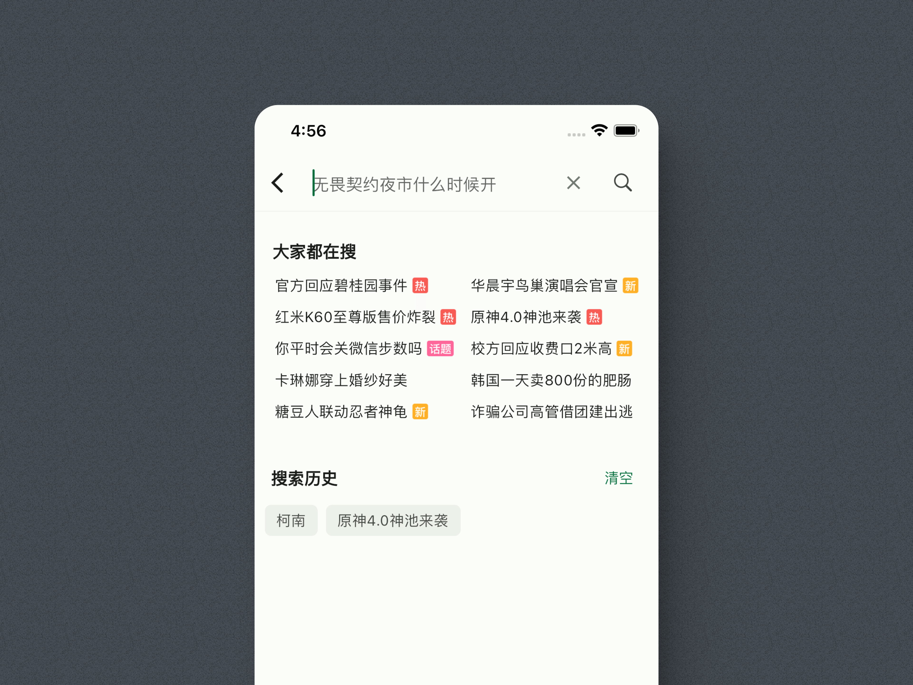
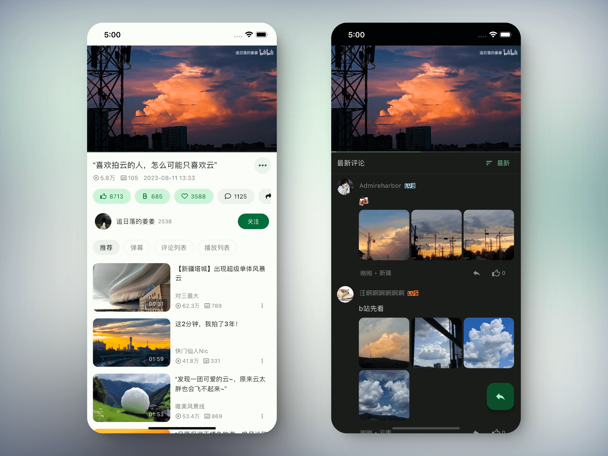
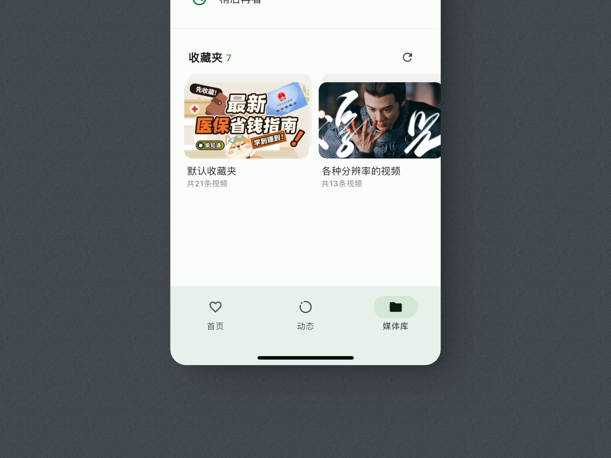
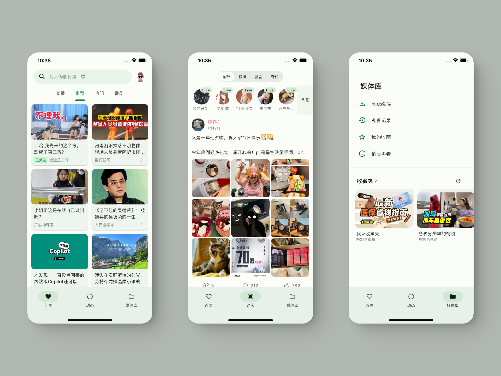

<div align="center">
    
</div>


<div align="center">
    <h1>PiliPro</h1>


<p>使用 Flutter 开发的 BiliBili 第三方客户端</p>
<p><b>本仓库是 <a href="https://github.com/bggRGjQaUbCoE/PiliPlus">PiliPlus</a> 的下游分支（downstream fork）。上游功能全部保留，另有一批本地改动。</b></p>




<br/>

</div>


<br/>

## 关于本仓库

| 项目 | 说明 |
| --- | --- |
| 本仓库 | [ESxyzbil/PiliPro](https://github.com/ESxyzbil/PiliPro) |
| 上游 | [bggRGjQaUbCoE/PiliPlus](https://github.com/bggRGjQaUbCoE/PiliPlus) |
| 上游的上游 | [orz12/PiliPalaX](https://github.com/orz12/PiliPalaX) → [guozhigq/pilipala](https://github.com/guozhigq/pilipala) |
| 当前同步基线 | PiliPlus 2.1.5 |
| 版本号 | `U5.1`（`pubspec` 为 `5.1.0+8`，显示名取 `U` + 主.次） |
| 许可 | GPL-3.0，沿用上游 [LICENSE](LICENSE)，未改动 |

- 本仓库是上游的**下游分支**，不是上游官方仓库，也不由上游作者维护。
- 上游的功能、设计与版权归上游作者；本仓库只在其基础上叠加本地改动，本地改动的行为与排障由本仓库负责。
- 同步策略：跟随上游主线 / tag 合并，本地功能尽量以独立 commit 保留，冲突处优先保留本地行为并写明原因。
- 反馈渠道：本地改动引起的问题请提到本仓库；上游自身的问题请提给上游，不要打扰上游作者。
- 覆盖安装：`applicationId` 与上游一致（`com.example.piliplus`）。签名一致可直接覆盖升级；签名不同需先卸载（会清数据），升级前建议先做一次「数据迁移」导包。

## 适配平台

- [x] Android
- [x] iOS
- [x] Pad
- [x] Windows
- [x] Linux

本地改动主要在 Android 与 Windows 上验证；iOS / Linux 未做对应适配验证。

[](https://repology.org/project/piliplus/versions)

<br/>

## 本仓库的本地改动

以下是与上游的差异清单。上游自带的功能见下文「上游功能」，这里不重复。

### 播放器

- [x] 封面飞行：列表卡片封面过渡到播放器，终点一次算准、无缝衔接播放器，中途打断可回位
- [x] 长按倍速横滑调速：下滑进入调速区后左右连续调速（0.25–4×），范围与手感曲线（线性 / 平方 / 根号）可调，胶囊全向跟手
- [x] 退出全屏 / 销毁播放器时按「屏幕旋转」开关重新下发方向策略（修「全屏回来屏幕转不动」）
- [x] 指令弹幕卡片：按服务端时间点浮出「打分 / 投票」卡，可直接操作
- [x] 弹幕歌词提取：顶置 / 底置、字幕池、高级弹幕多来源，按发布者聚类 + 同期去重，只取主歌词作者
- [x] 弹幕歌词单曲锁定 / 全局默认源（与 CC 字幕同一套机制），重进不再重新搜索
- [x] 歌词搜索：识别 B 站「发现《歌名》」官方标签；新增汽水音乐（火山引擎）音源，免登录免签名
- [x] 音源校验只认 `duration > 0`，避免 mpv「先 playing 后报错」造成的假成功

### 音频

- [x] 收藏夹耳机图标：在线进入音频页走「视频页→听音频」同一套参数；离线条目直接进离线音频页
- [x] 仅音频缓存（`mediaType=3`，只落 `audio.m4s`、不占画面），与视频缓存双向隔离
- [x] 音频取流三层兜底：listener PlayURL → web playurl（HTTP/1.1 + Range）→ 下载到本地再播
- [x] 音频默认播放顺序（无序 / 正序 / 倒序 / 随机），任何排序都把当前播放项置顶；排序菜单右侧锁图标可直接设默认
- [x] Windows 桌面歌词悬浮窗（置顶独立窗口，透明度 / 字号 / 字体 / 描边 / 位置可调）+ SMTC 媒体信息回传

### 界面与交互

- [x] 毛玻璃五类独立（顶栏 / 底栏 / 视频卡片 / 信息卡片 / 后景），各自开关 + 模糊强度 + 不透明度 + 颜色
- [x] 全局背景层：背景图统一由全局层渲染，路由切换交叉淡入淡出，push 时背景不再瞬间跳变
- [x] 页面过渡重构：旧页先淡出、新页后淡入错峰，半透明填充，getx fork 透明过渡
- [x] 预测性返回手势（Android / 桌面）：跟手动画、进入与退出分离、可回滚
- [x] 返回拦截修复：评论详情返回不再退回桌面（非 modal bottomSheet 显式关闭）
- [x] 多页面标签（桌面 + 手机）：侧边标签栏多开视频 / 专栏，切换与关闭动画，切走标签自动转音频
- [x] 圆形屏幕适配：顶栏 / 底栏内容居中，全屏播放页下半圆弧进度条
- [x] 应用内 PPI 调节（80–1000 PPI，预设 120 / 160 / 240 / 320 / 480 / 640）
- [x] 横屏适配拆为独立设置项（布局模式 / 宽高比阈值 / 允许旋转）+ 反转滚轮开关
- [x] 滚动回弹：禁用 Android overscroll stretch，信息流卡片不再拉伸变形，改为弹性回弹
- [x] 收藏夹桌面快捷方式（不打开 App 也能直达某个收藏夹）

### 本地保存与数据

- [x] 保存到本地直接输出 H.264 + AAC 的 MP4，流式写入（修长视频 OOM）
- [x] 保存进度条：阶段间百分比连续不倒退，下滑可隐藏到后台
- [x] 保存任务支持取消；Android 16 用实时活动通知展示进度
- [x] 双通道转码：Windows（Media Foundation）/ Android（MediaTranscoder）
- [x] 数据迁移：一键导出离线包（可勾选范围、可估算体积、默认落到系统共享下载目录）并导入还原
- [x] 收藏夹离线缓存 + 全量扫描本地缓存条目
- [x] 离线模式切歌（音频模式，从正确索引开始播放）
- [x] 合集缓存

<br/>

## 上游功能

以下为上游 PiliPlus 自带、本仓库同样具备的功能。

### refactor

- [ ] gRPC [wip]
- [x] 用户界面
- [x] 其他

### feat

- [x] 编辑动态
- [x] DLNA 投屏
- [x] 离线缓存/播放
- [x] 移动端支持点击弹幕悬停，点赞、复制、举报 by [@My-Responsitories](https://github.com/My-Responsitories)
- [x] 播放音频
- [x] 跳过番剧片头/片尾
- [x] 安卓端 `loudnorm` 适配 by [@My-Responsitories](https://github.com/My-Responsitories)
- [x] Win/Mac 支持极验、短信登录 by [@My-Responsitories](https://github.com/My-Responsitories)
- [x] 视频截取动图 by [@My-Responsitories](https://github.com/My-Responsitories)
- [x] AI 原声翻译
- [x] SuperChat
- [x] 播放课堂视频
- [x] 发起投票
- [x] 发布动态/评论支持`富文本编辑`/`表情显示`/`@用户`
- [x] 修改消息设置
- [x] 修改聊天设置
- [x] 展示折叠消息
- [x] 查看用户图文
- [x] 动态话题
- [x] 直播分区
- [x] 分享`视频`/`番剧`/`动态`/`专栏`/`直播`至消息
- [x] 创建/修改/删除关注分组
- [x] 移除粉丝
- [x] 直播弹幕发送表情
- [x] 收藏夹排序
- [x] 稍后再看 ~~`未看`~~ / `未看完` / ~~`已看完`~~ 分类
- [x] WebDAV 备份/恢复设置
- [x] 保存评论/动态
- [x] 高级弹幕 by [@My-Responsitories](https://github.com/My-Responsitories)
- [x] 取消/置顶评论
- [x] 记笔记
- [x] 多账号支持 by [@My-Responsitories](https://github.com/My-Responsitories)
- [x] 屏蔽带货动态/评论
- [x] 互动视频
- [x] 发评/动态反诈
- [x] 高能进度条
- [x] 滑动跳转预览视频缩略图
- [x] Live Photo
- [x] 复制/移动/排序收藏夹/稍后再看视频
- [x] 超分辨率
- [x] 合并弹幕
- [x] 会员彩色弹幕
- [x] 播放全部/继续播放/倒序播放
- [x] Cookie登录
- [x] 显示视频分段信息
- [x] 调节字幕大小
- [x] 调节全屏弹幕大小
- [x] 收藏夹/稍后再看多选删除
- [x] 搜索用户动态
- [x] 直播弹幕
- [x] 修改头像/用户名/签名/性别/生日
- [x] 创建/编辑/删除收藏夹
- [x] 评论楼中楼查看对话
- [x] 评论楼中楼定位点击查看的评论
- [x] 评论楼中楼按热度/时间排序
- [x] 评论点踩
- [x] 私信发图
- [x] 投币动画
- [x] 取消/追番，更新追番状态
- [x] 取消/订阅合集
- [x] SponsorBlock
- [x] 显示视频完整合集
- [x] 三连动画
- [x] 番剧三连
- [x] 带图评论
- [x] 视频TAG
- [x] 筛选搜索
- [x] 转发动态
- [x] 合集图片
- [x] 删除/置顶/撤回私信
- [x] 举报用户/评论/视频/动态
- [x] 删除/发布/置顶文本/图片动态

### opt

- [x] 专栏界面
- [x] 私信界面
- [x] 收藏面板
- [x] PIP
- [x] 视频封面
- [x] 回复界面
- [x] 系统通知
- [x] 评论显示
- [x] 亮度调节
- [x] 视频播放
- [x] 视频staff
- [x] 防止bottomsheet遮挡全屏视频

### fix

- [x] 番剧分集点赞/投币/收藏
- [x] bugs

<br/>

### 功能

- [x] 推荐视频列表(app端)
- [x] 最热视频列表
- [x] 热门直播
- [x] 番剧列表
- [x] 屏蔽黑名单内用户视频
- [x] 无痕模式（播放视为未登录）
- [x] 游客模式（推荐视为未登录）

- [x] 用户相关
  - [x] 粉丝、关注用户、拉黑用户查看
  - [x] 用户主页查看
  - [x] 关注/取关用户
  - [x] 离线缓存
  - [x] 稍后再看
  - [x] 观看记录
  - [x] 我的收藏
  - [x] 站内私信

- [x] 动态相关
  - [x] 全部、投稿、番剧分类查看
  - [x] 动态评论查看
  - [x] 动态评论回复功能

- [x] 视频播放相关
  - [x] 双击快进/快退
  - [x] 双击播放/暂停
  - [x] 垂直方向调节亮度/音量
  - [x] 垂直方向上滑全屏、下滑退出全屏
  - [x] 水平方向手势快进/快退
  - [x] 全屏方向设置
  - [x] 倍速选择/长按2倍速
  - [x] 硬件加速（视机型而定）
  - [x] 画质选择（高清画质未解锁）
  - [x] 音质选择（视视频而定）
  - [x] 解码格式选择（视视频而定）
  - [x] 弹幕
  - [x] 字幕
  - [x] 记忆播放
  - [x] 视频比例：高度/宽度适应、填充、包含等

- [x] 搜索相关
  - [x] 热搜
  - [x] 搜索历史
  - [x] 默认搜索词
  - [x] 投稿、番剧、直播间、用户搜索
  - [x] 视频搜索排序、按时长筛选

- [x] 视频详情页相关
  - [x] 视频选集(分p)切换
  - [x] 点赞、投币、收藏/取消收藏
  - [x] 相关视频查看
  - [x] 评论用户身份标识
  - [x] 评论(排序)查看、二楼评论查看
  - [x] 主楼、二楼评论回复功能
  - [x] 评论点赞
  - [x] 评论笔记图片查看、保存

- [x] 设置相关
  - [x] 画质、音质、解码方式预设
  - [x] 图片质量设定
  - [x] 主题模式：亮色/暗色/跟随系统
  - [x] 震动反馈(可选)
  - [x] 高帧率
  - [x] 自动全屏
  - [x] 横屏适配

<br/>

## 下载

- 发布页：[Releases](https://github.com/ESxyzbil/PiliPro/releases)，或拉取代码到本地自行编译。
- 自行编译按平台区分产物；需要 OCR / ASR 字幕工作台时默认不编入，加开关：

```bash
flutter build apk --release --dart-define=ENABLE_OCR=true --dart-define=ENABLE_ASR=true
```

<br/>

## 声明

本仓库（PiliPro）是 [PiliPlus](https://github.com/bggRGjQaUbCoE/PiliPlus) 的**下游分支（downstream fork）**，不是上游官方仓库，也不由上游作者维护。

- 上游作者与贡献者对其代码保留全部权利；本仓库只在其基础上叠加本地改动，本地改动的行为、稳定性与排障由本仓库负责，不代表上游立场。
- 传承链：[guozhigq/pilipala](https://github.com/guozhigq/pilipala) → [orz12/PiliPalaX](https://github.com/orz12/PiliPalaX) → [bggRGjQaUbCoE/PiliPlus](https://github.com/bggRGjQaUbCoE/PiliPlus) → 本仓库。致敬原作者与上游作者的开源精神。
- 本项目为个人兴趣开发，仅用于学习和测试，请于下载后 24 小时内删除。
- 所用 API 皆从官方网站收集，不提供任何破解内容。
- 上游同步可能滞后；遇到问题请先在本仓库确认是否由本地改动引起，本地改动的问题请提到本仓库。

感谢使用


<br/>

## 致谢

- [bggRGjQaUbCoE/PiliPlus](https://github.com/bggRGjQaUbCoE/PiliPlus)（上游）
- [orz12/PiliPalaX](https://github.com/orz12/PiliPalaX)
- [guozhigq/pilipala](https://github.com/guozhigq/pilipala)
- [bilibili-API-collect](https://github.com/SocialSisterYi/bilibili-API-collect)
- [flutter_meedu_videoplayer](https://github.com/zezo357/flutter_meedu_videoplayer)
- [media-kit](https://github.com/media-kit/media-kit)
- [dio](https://pub.dev/packages/dio)
- 等等

<br/>
<br/>
<br/>

## Star History

<a href="https://star-history.dera.page/#ESxyzbil/PiliPro&Date">
 <picture>
   <source media="(prefers-color-scheme: dark)" srcset="https://star-history.dera.page/svg?repos=ESxyzbil/PiliPro&type=Date&theme=dark" />
   <source media="(prefers-color-scheme: light)" srcset="https://star-history.dera.page/svg?repos=ESxyzbil/PiliPro&type=Date" />
   
 </picture>
</a>
